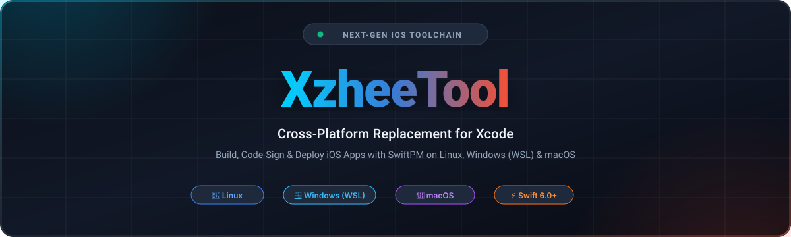

<div align="center">

  

  <br/>

  <p align="center">
    <a href="LICENSE.md"></a>
    <a href="https://swift.org"></a>
    <a href="https://github.com/zheedevVn"></a>
    
  </p>

  <p align="center">
    <a href="#english"></a>
    &nbsp;&nbsp;
    <a href="#tieng-viet"></a>
  </p>

  <br/>

| 🚀 Không Cần Máy Mac | ⚡ Cài Đặt Trực Tiếp USB | 🔐 Tự Động Ký Số | 📦 Chuẩn SwiftPM Thuần |
| :---: | :---: | :---: | :---: |
| Biên dịch iOS trên Linux / WSL | Nạp & chạy app trên iPhone thật | Quản lý Profile & Certificate | Hoàn toàn theo chuẩn mở |

</div>

---

## 📌 Giới thiệu dự án (Project Description)

> **XzheeTool** là bộ công cụ dòng lệnh (CLI) và thư viện mã nguồn mở toàn diện, mang khả năng phát triển, biên dịch, ký số và nạp ứng dụng iOS lên các hệ điều hành **Linux**, **Windows (WSL)** và **macOS** mà hoàn toàn **không cần đến máy Mac hay phần mềm Xcode**.

### Tại sao lại có XzheeTool?
Trước đây, việc phát triển ứng dụng iOS luôn bị gắn chặt vào máy tính Mac và bộ công cụ Xcode độc quyền của Apple. **XzheeTool** được tạo ra để xóa bỏ rào cản đó:
- **Tự do nền tảng**: Lập trình viên sử dụng máy tính Linux hoặc Windows có thể thoải mái viết code Swift, tự động tải Darwin SDK và build ra file cài đặt `.ipa`.
- **Tự động hóa hoàn toàn**: Không cần cấu hình chứng chỉ phức tạp. XzheeTool tự đăng nhập Apple ID, cấp phát Provisioning Profile, ký số ứng dụng và nạp thẳng vào iPhone cắm qua dây USB trong vòng vài giây.
- **Chuẩn SwiftPM mở**: Không cần cấu trúc file `.xcodeproj` phức tạp. Mọi thứ vận hành trực tiếp trên file cấu hình tiêu chuẩn `Package.swift`.

---

<a id="tieng-viet"></a>
## 🇻🇳 Hướng Dẫn Sử Dụng (Tiếng Việt)

### Tính năng cốt lõi

1. **Biên dịch không phụ thuộc Xcode**:
   - Sử dụng Swift Package Manager chuẩn để biên dịch mã nguồn Swift thành ứng dụng iOS có thể chạy được trên thiết bị thật.
2. **Ký số & Cấp chứng chỉ tự động (Automated Provisioning & Signing)**:
   - Tự động giao tiếp với Apple Developer Portal để tạo và tải Certificate, App ID và Mobileprovision Profile.
   - Tự động phân tích và nhúng các quyền hạn đặc biệt (Entitlements: Push Notifications, App Groups, Keychain Sharing...).
3. **Giao tiếp thiết bị qua USB (Native Device Interaction)**:
   - Giao tiếp trực tiếp với iPhone/iPad thông qua giao thức `usbmuxd`.
   - Hỗ trợ cài đặt file `.ipa`, gỡ cài đặt, khởi chạy ứng dụng (Launch) và debug trực tiếp trên máy thật.
4. **Tích hợp API dịch vụ Apple Developer**:
   - Đăng nhập xác thực hai yếu tố (2FA / Anisette) an toàn.
   - Quản lý thiết bị đã đăng ký, tài khoản Teams và App Store Connect.

---

### Yêu cầu hệ thống & Cài đặt

#### 1. Trên Linux / Windows (WSL)
- **Swift Toolchain**: Cài đặt Swift 6.0 trở lên từ [swift.org/install/linux](https://swift.org/install/linux).
- **USB Daemon (`usbmuxd`)**: Cần thiết để giao tiếp với thiết bị iOS qua cổng USB:
  ```bash
  sudo apt-get update
  sudo apt-get install usbmuxd libimobiledevice6
  ```
- **Người dùng Windows**: Cài đặt WSL2 kết hợp với tiện ích [usbipd-win](https://github.com/dorssel/usbipd-win) để chia sẻ cổng cắm iPhone từ Windows vào bên trong môi trường WSL.

#### 2. Trên macOS
- Yêu cầu macOS 14.0 (Sonoma) trở lên cùng bộ công cụ Swift 6.0+.

---

### Bảng lệnh CLI thường dùng

```bash
# Khởi tạo một dự án ứng dụng iOS mới
$ xzheetool new --name HelloiOS

# Đăng nhập tài khoản Apple Developer để cấp chứng chỉ
$ xzheetool auth login

# Tải và cấu hình bộ Darwin Swift SDK tự động
$ xzheetool sdk install

# Kiểm tra danh sách thiết bị iOS đang cắm vào máy tính
$ xzheetool devices

# Tự động biên dịch, ký số, cài đặt và khởi chạy app lên iPhone
$ xzheetool dev

# Cài đặt file .ipa có sẵn lên máy
$ xzheetool install MyApp.ipa
```

#### Quy trình thực thi thực tế khi chạy lệnh `xzheetool dev`:

```text
$ xzheetool dev
Planning build...
Compiling Swift sources...
[8/8] Linking HelloApp
Build complete in 4.2s!

Detecting connected device...
Found target: iPhone (UDID: 00008110-001234567890ABCD)

[1/6] Chuẩn bị môi trường thiết bị      [OK] 100%
[2/6] Lấy chứng chỉ & cấu hình nạp     [OK] 100%
[3/6] Thực hiện ký số ứng dụng (Sign)   [OK] 100%
[4/6] Đóng gói thành tệp .ipa          [OK] 100%
[5/6] Nạp ứng dụng qua cổng USB         [OK] 100%
[6/6] Khởi chạy ứng dụng trên thiết bị [OK] 100%

Ứng dụng đã khởi chạy thành công trên màn hình iPhone!
```

---

### Nhúng thư viện `XKit` vào dự án Swift

Bạn có thể tận dụng toàn bộ logic quản lý chứng chỉ, giao tiếp Apple Developer Services và tương tác thiết bị iOS trong ứng dụng của riêng mình:

```swift
// Package.swift
dependencies: [
    .package(url: "https://github.com/zheedevVn/XzheeTool.git", branch: "main")
],
targets: [
    .target(
        name: "MyTool",
        dependencies: [
            .product(name: "XKit", package: "XzheeTool")
        ]
    )
]
```

---

<a id="english"></a>
## 🌐 Documentation (English)

### Core Capabilities

- **Zero Xcode Dependency**: Build SwiftPM packages into full-fledged iOS `.ipa` applications on Linux and Windows.
- **Integrated Provisioning & Signing**: Automatic certificate management, mobile provisioning profile handling, and app signing.
- **Direct Device Communication**: Deploy, install, launch, debug, and manage iOS devices over USB via native protocol implementations.
- **Apple Developer Services API**: Programmatic authentication and control over App Store Connect and Developer portal resources.

---

### Command Line Interface Reference

```bash
$ xzheetool --help
OVERVIEW: Cross-platform iOS development and deployment toolkit.

USAGE: xzheetool <subcommand>

CONFIGURATION SUBCOMMANDS:
  setup                   Set up toolchain and dependencies for iOS development
  auth                    Manage Apple Developer Services authentication
  sdk                     Manage the Darwin Swift SDK

DEVELOPMENT SUBCOMMANDS:
  new                     Create a new XzheeTool SwiftPM iOS project
  dev                     Build, sign, install, and run an iOS project in real time
  ds                      Interact with Apple Developer Services

DEVICE SUBCOMMANDS:
  devices                 List connected iOS devices
  install                 Install an .ipa file to a target device
  uninstall               Uninstall an app from a device
  launch                  Launch an installed application on device
```

---

### Library Integration

Integrate **XKit** as a SwiftPM dependency into your custom Swift tools:

```swift
// Package.swift
dependencies: [
    .package(url: "https://github.com/zheedevVn/XzheeTool.git", branch: "main")
],
targets: [
    .target(
        name: "CustomApp",
        dependencies: [
            .product(name: "XKit", package: "XzheeTool")
        ]
    )
]
```

---

## 👨‍💻 Tác giả & Bản quyền / Author & License

- **Tác giả / Author**: **Hồ Đức Minh (zheedevVn)**
- **GitHub Profile**: [@zheedevVn](https://github.com/zheedevVn)
- **Repository**: [https://github.com/zheedevVn/XzheeTool](https://github.com/zheedevVn/XzheeTool)
- **Email**: [minhbach251207@gmail.com](mailto:minhbach251207@gmail.com)
- **Giấy phép / License**: Phát hành theo giấy phép [MIT License](LICENSE.md). Toàn quyền sử dụng, sửa đổi và phân phối thương mại/phi thương mại.
